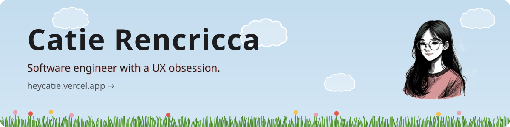

<!-- Generated by scripts/generate-readme.ts in crencricca/portfolio. Edit src/data/resume.ts there, then run npm run readme. -->

Hi, I'm Catie! I'm a Software Engineer at [TED Conferences](https://www.ted.com) in New York City. Passionate about intuitive UX, scalable UI systems, and modern web architecture.

### 🌷 In the garden

<table>
  <tr><td width="50%" valign="top"><b><a href="https://github.com/crencricca/Wish-You-Were-Here">Wish You Were Here</a></b> 🌱 growing A Windows 95 desktop rebuilt in Godot, with draggable windows, folders, a text editor, and a taskbar, hiding a mystery you uncover by digging through the files.</td><td width="50%" valign="top"> <b><a href="https://localhosting.vercel.app">Local Host</a></b> A social coordination app, built for the web with Next.js and for mobile with React Native.</td></tr>
  <tr><td width="50%" valign="top"> <b><a href="https://github.com/crencricca/witchy-advice">Witchy Advice</a></b> A potion-brewing mini-game.</td><td width="50%" valign="top"> <b><a href="https://github.com/crencricca/coffee-shop-simulator">Coffee Shop Simulator</a></b> Discover new recipes by combining ingredients.</td></tr>
  <tr><td width="50%" valign="top"><b><a href="https://github.com/crencricca/flumph">Flumph</a></b> 🌱 growing A D&amp;D-inspired, turn-based roguelike where the game acts as your dungeon master. Dice decide the outcomes, branching paths sit under fog of war, and you upgrade a camp between runs.</td></tr>
</table>

Also sprouting:
- [AOL Chat](https://github.com/crencricca/aol-chat) · A nostalgic chat interface for anyone else who misses AIM.
- [Native Weather](https://github.com/crencricca/native-weather) · Today's and yesterday's weather, side by side.
- [Calendar](https://github.com/crencricca/calendar) · Plan events with friends.

### [Explore the interactive resume →](https://heycatie.vercel.app)

[LinkedIn](https://www.linkedin.com/in/catierencricca/)

Last updated Oct 2026
